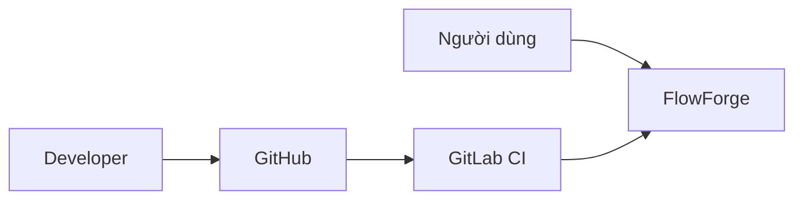
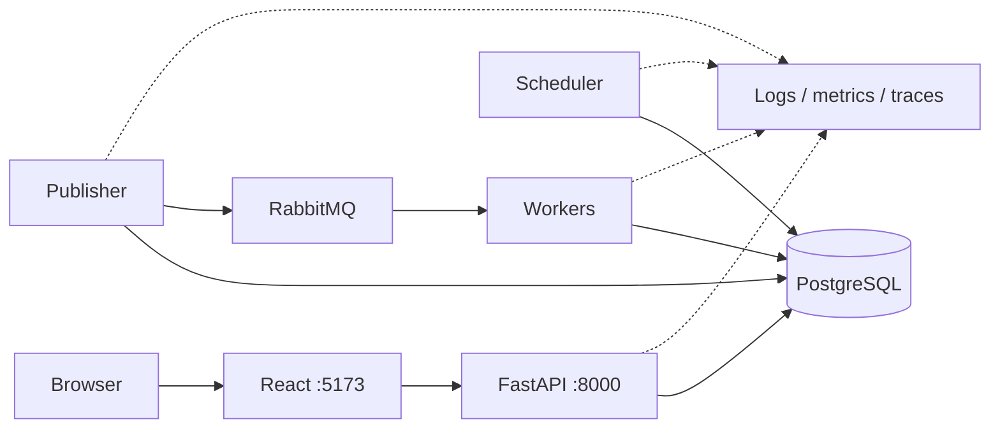
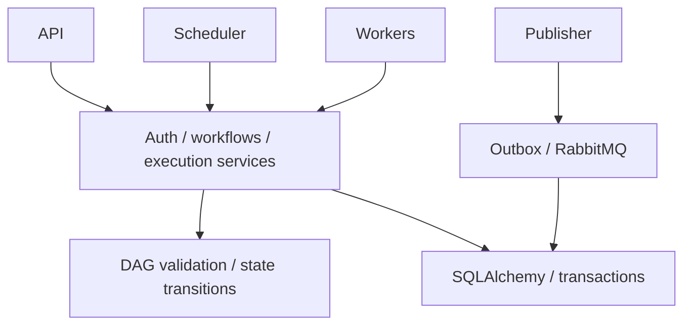
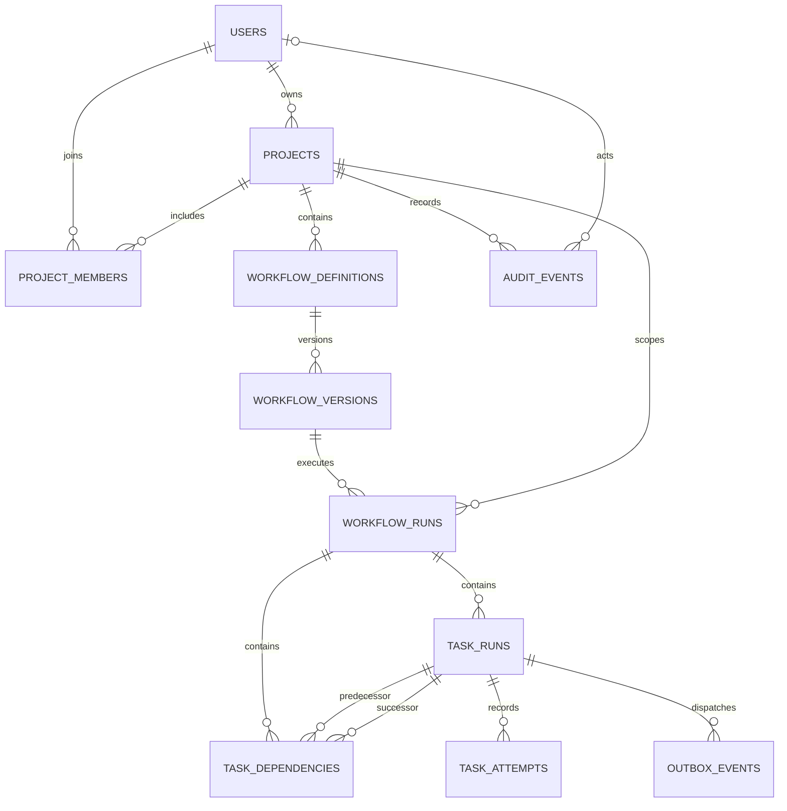
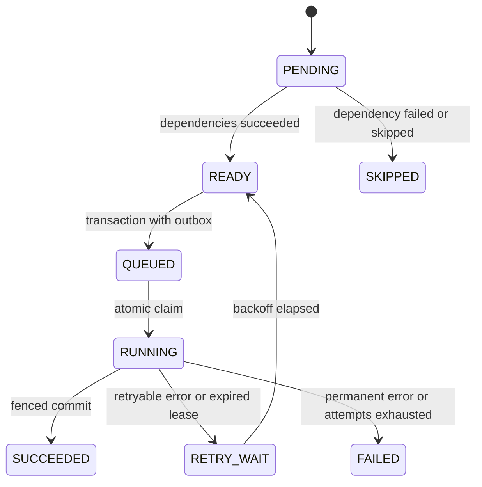
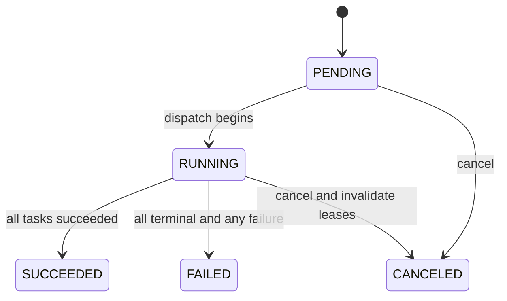
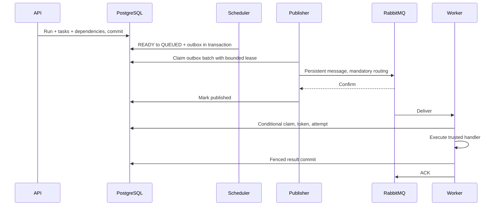
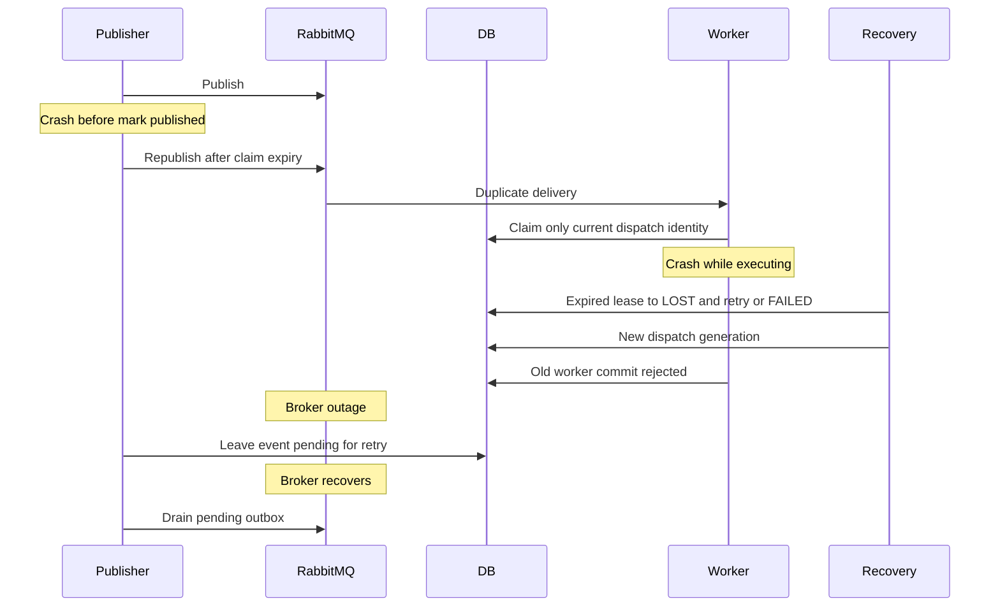
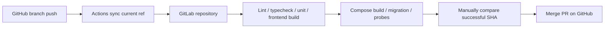

# Kiến trúc FlowForge

Trạng thái: API health, Auth/Projects/membership, migrations identity/sessions, DAG/message validation,
process lifecycle và giao diện kết nối đã có code. Workflow engine và login UI vẫn chưa triển khai.
Nguồn chính: tài liệu trong repo và [progress plan v2](../../tasks/plan.md).
Xem [execution contracts v1](execution-contracts.md) cho DAG, handler, transaction, broker và limits.

## 1 System context

## 2 Container và deployment

Compose là một host local, DB/broker chỉ trong network nội bộ, named volumes riêng. Migration là one-shot trước các process. Observability hiện có JSON logs; metrics/traces bổ sung tuần 9.
Một image backend, entrypoint API bằng uvicorn, các role còn lại qua python -m flowforge.process ROLE. Role scaffold chỉ probe dependency, chưa consume/schedule.

## 3 Module boundaries

Domain không import FastAPI, SQLAlchemy hoặc RabbitMQ. Service sở hữu transaction; không giữ lock trong lúc handler chạy.
Scaffold hiện dùng api.py, persistence.py và process.py; tách thành package khi tính năng tương ứng xuất hiện, không tạo module rỗng.

## 4 ERD

Xem data-model.md cho cột, constraint và migration staging.

## 5 State machines

Mọi task chưa terminal có thể chuyển CANCELED khi hủy run. Terminal không chuyển trạng thái.
Independent branches tiếp tục nếu một nhánh lỗi; descendants bị SKIPPED. Run hoàn tất khi tất cả task terminal.

Attempt: RUNNING → SUCCEEDED / FAILED / LOST / CANCELED. Lease timeout ghi LOST; retry mới tạo attempt_no mới.
Hủy run khóa row run trước task, vô hiệu token và hủy task chưa terminal trong một transaction. Worker commit cũng kiểm tra run và token theo cùng lock order. Không hoàn tác external side effects.

## 6 Dispatch thành công

Publisher claim transaction kết thúc trước network I/O. Claim hết hạn được lấy lại. Durable exchange/queue, persistent messages, publisher confirms và manual ACK.
Message cũ/trùng được ACK khi DB chứng minh không còn hợp lệ; lỗi DB không ACK. Invalid envelope chuyển dead-letter queue để tránh vòng lặp poison message.

## 7 Recovery

DB time quyết định lease deadline; heartbeat chỉ gia hạn token hiện hành và không vượt hard deadline. Lease 30s/heartbeat 10s là deployment policy; timeout/retry snapshot trong immutable version. Permanent error không retry.
QUEUED chờ quá 60s chỉ redrive cùng event/generation, không vô hiệu message đang chờ. Chỉ retry sau một attempt mới thay generation; xem execution-contracts.md.
Handler chạy ngoài transaction; không cho người dùng nộp mã Python/shell.

## 8 CI flow

## Contracts

API prefix /api/v1; snake_case; UUID string; timestamps UTC; limit/offset default 20 max 100.
Planned endpoints: POST auth/login; GET auth/me; GET/POST projects; GET/POST projects/{id}/workflows; POST workflows/{id}/versions; GET workflows/{id}/versions/{version}; POST workflows/{id}/runs; GET runs; GET runs/{id}; GET runs/{id}/tasks; GET tasks/{id}/attempts; POST runs/{id}/cancel.
Run input: version (positive integer), input (JSON object). POST run returns 202 with run_id and status. Optional Idempotency-Key scoped to project: canonical hash includes workflow ID, explicit version and input; equal key/hash returns original run, different hash returns 409. Keys retained with run.
Errors: code, message, details, request_id. Invalid input 422, unauthenticated 401, cross-project 404, insufficient role within visible project 403.
Auth MVP: local bootstrap-user command, no public registration, Argon2 passwords; JWT access tokens expire in 30 minutes. OWNER manages membership/workflows/runs; DEVELOPER publishes and runs; VIEWER reads. Owner membership maintained atomically.
Message v1: schema_version, event_id, run_id, task_run_id, dispatch_generation, traceparent (optional). Task data stays in DB; consumer checks schema and current generation.
Health, Auth, Projects/membership, Workflow/draft/version and Run/Task persistence routes are implemented. Run execution remains planned. See [workflow API](../development/workflows.md) and [run API](../development/runs.md).
Auth now includes rotating HttpOnly refresh cookies and server-side session revocation per the accepted
2026-11-16 plan. See [auth contracts and usage](../development/auth.md).

## Sources

- [FastAPI lifespan](https://fastapi.tiangolo.com/advanced/events/)
- [RabbitMQ reliability](https://www.rabbitmq.com/docs/reliability)
- [PostgreSQL row locks](https://www.postgresql.org/docs/current/explicit-locking.html)
